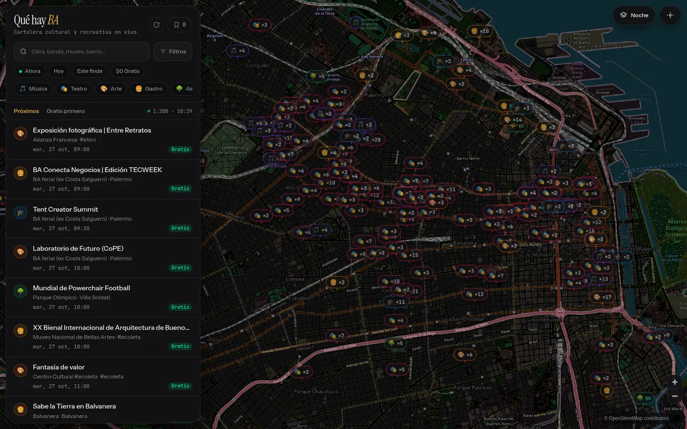
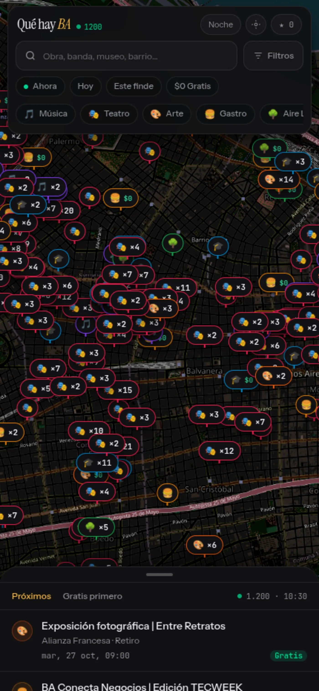

# Qué Hay BA

Agenda cultural de la Ciudad de Buenos Aires sobre un mapa interactivo. Reúne eventos de tres fuentes públicas, los normaliza y geocodifica, y los publica como una cartelera filtrable por categoría, barrio, fecha y precio.

Buenos Aires cultural events on a map. Next.js + Postgres, three public sources, one GeoJSON API. MIT.

[](https://github.com/Juan-Martin-Cerezo/que-hay-ba/actions/workflows/ci.yml)
[](./LICENSE)

Demo: https://que-hay-ba.vercel.app



## Qué hace

- **Ingesta de tres fuentes**: agenda oficial del GCBA (Linda), Alternativa Teatral y Eventbrite. Cada fuente tiene su parser en `src/ingest/sources/`.
- **Normalización**: clasificación en seis categorías, detección de eventos gratuitos, rangos de precio en ARS y deduplicación entre fuentes por título, sede y franja horaria.
- **Geocodificación en cascada**: coordenadas del origen → catálogo de sedes de CABA → caché en base → USIG (GCBA) → Nominatim acotado al polígono de la ciudad.
- **Mapa**: MapLibre con tiles de OpenStreetMap y del mapa oficial del GCBA. Los eventos de una misma sede se agrupan en un solo pin y se abren en un popover.
- **Filtros**: ahora, hoy, este fin de semana, fecha exacta, categoría, rango de precio, barrio y búsqueda libre.
- **Ficha de evento**: próxima función, precio, sede, distancia, botón para agregar a Google Calendar, cómo llegar y favoritos guardados en `localStorage`.



## Stack

| Capa | Tecnología |
| --- | --- |
| Frontend | Next.js 16 (App Router), React 19, Tailwind CSS 4 |
| Mapa | MapLibre GL JS |
| Base de datos | PostgreSQL 14+ (probado con Supabase y con Postgres local) |
| Cliente SQL | `postgres` (postgres.js) |
| Ingesta | `tsx` + scripts en `src/ingest/` |

## Cómo correrlo

Requisitos: Node 20 o superior y una base PostgreSQL (local o Supabase).

```bash
git clone https://github.com/Juan-Martin-Cerezo/que-hay-ba.git
cd que-hay-ba
npm install
cp .env.example .env.local   # completá DATABASE_URL
npm run db:setup             # migraciones + sedes + primera ingesta
npm run dev                  # http://localhost:3000
```

Si tu base es local, arrancá con:

```bash
createdb quehayba
export DATABASE_URL=postgres://localhost:5432/quehayba
```

El schema está en `supabase/migrations/`. Las migraciones son re-ejecutables y se aplican en orden alfabético, así que `npm run db:setup` también sirve para actualizar una base existente.

## Variables de entorno

| Variable | Obligatoria | Para qué |
| --- | --- | --- |
| `DATABASE_URL` | sí | Conexión a Postgres. Con Supabase, usá el connection string del **transaction pooler** (puerto 6543). |
| `CRON_SECRET` | sí en producción | Token que protege `/api/cron/:source`. Si falta, el endpoint responde 401. |
| `PERPETUAL_EVENTS` | no | `false` hace que los eventos vencidos se borren. Por defecto se reprograman cada 7 días para que el mapa no quede vacío entre ingestas (ver más abajo). |

## Ingesta

```bash
npm run ingest                                   # las tres fuentes
npx tsx scripts/ingest.ts --source=gcba          # una sola
npx tsx scripts/ingest.ts --migrate --seed       # migraciones + sedes
```

En producción, `vercel.json` programa las tres fuentes a las 8:00, 8:20 y 8:40 (hora argentina) y llama a `/api/cron/:source` con `Authorization: Bearer $CRON_SECRET`. En cualquier otro hosting se puede llamar al mismo endpoint desde un cron externo.

**Sobre `PERPETUAL_EVENTS`:** el modo perpetuo (por defecto) mueve los eventos ya vencidos en saltos de 7 días para conservar día de la semana y horario. Es útil para demos y para ciclos semanales, pero significa que el mapa muestra ocurrencias futuras que no necesariamente existen. Si querés una agenda estrictamente fiel a las fuentes, poné `PERPETUAL_EVENTS=false`: los eventos con fecha vencida se eliminan después de 24 horas.

## API

| Endpoint | Descripción |
| --- | --- |
| `GET /api/events` | GeoJSON de eventos. Query params: `when` (`now`, `today`, `weekend`, `YYYY-MM-DD`), `cat` (lista separada por comas), `price` (`free`, `eco`, `mod`, `premium`), `q`. |
| `GET /api/events/:id` | Ficha completa de un evento, con próximas funciones. |
| `GET /api/cron/:source` | Dispara la ingesta de una fuente (`gcba`, `alternativa`, `eventbrite`). Requiere `CRON_SECRET`. |
| `GET /api/health` | Estado de la base. Devuelve 503 con el motivo si `DATABASE_URL` falta o Postgres no responde. |

## Deploy

1. Creá una base Postgres y corré las migraciones: `npx tsx scripts/ingest.ts --migrate --seed`.
2. Importá el repo en Vercel (o en cualquier host Node) y definí `DATABASE_URL` y `CRON_SECRET`.
3. Programá las ingestas. Con Vercel, `vercel.json` ya lo hace; en otros hosts, apuntá un cron a `/api/cron/gcba` y compañía con el header de autorización.

No hay ningún servicio propietario en el camino crítico: si no usás Supabase ni Vercel, alcanza con un Postgres y un cron.

## Estructura

```
src/app/            rutas, layout y API (Next.js App Router)
src/components/     mapa, filtros, cartelera y ficha de evento
src/ingest/         fuentes, normalización, geocodificación y upsert
src/lib/            acceso a base, dominio, formato y favoritos
scripts/ingest.ts   CLI de ingesta y migraciones
supabase/           SQL de migraciones
docs/               arquitectura y fuentes de datos
```

Más detalle en [`docs/ARCHITECTURE.md`](docs/ARCHITECTURE.md) y [`docs/DATA-SOURCES.md`](docs/DATA-SOURCES.md).

## Fuentes y atribución

Los datos pertenecen a sus publicadores. El proyecto linkea siempre a la página original de cada evento y no redistribuye contenido completo. La cartografía es de [OpenStreetMap](https://www.openstreetmap.org/copyright) y del [mapa oficial del GCBA (USIG)](https://servicios.usig.buenosaires.gob.ar). Los términos de cada fuente y las precauciones para scrapear están en [`docs/DATA-SOURCES.md`](docs/DATA-SOURCES.md).

## Cómo contribuir

Los issues y los pull requests son bienvenidos. Antes de abrir un PR, leé [`CONTRIBUTING.md`](CONTRIBUTING.md) y corré `npm run lint`, `npm run typecheck` y `npm test`.

Buenas primeras contribuciones:

- Tests de parser con fixtures HTML guardados (las tres fuentes cambian su markup sin aviso).
- Agrupar pines por zoom en vez de recortar por cantidad.
- Sumar fuentes nuevas (CCK, centros culturales barriales, universidades).
- Accesibilidad de la cartelera y del popover del mapa.

## Licencia

MIT. Ver [`LICENSE`](LICENSE).
